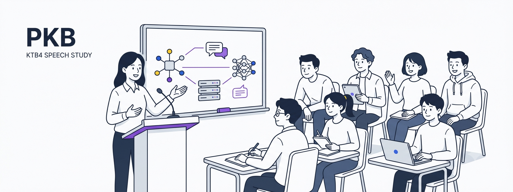

# KTB4 Speech Study

> 컴퓨터과학에 필요한 개념 지식(CS/OS, Network, AI 등)을 발표할 수 있는 수준까지 학습하고, 주제별 발표 자료와 검증 질문을 기록하는 공동 Repository.

## 1. 스터디 소개

- 목표: 각 주제를 발표(스피치)할 수 있는 수준까지 학습함
- 완료 기준: 디렉토리별 "검증 질문 목록"의 모든 항목을 자료 없이 설명할 수 있음
- 진행 방식: 각 디렉토리 README의 "진행 방식" 섹션 참고

## 2. 팀원

표 1. 팀원 구성
| 이름 | GitHub |
| ------------- | ------------------------------------------ |
| Linda.hwang | [@Subin9227](https://github.com/Subin9227) |
| Whale.lim | [@whale5500d](https://github.com/whale5500d) |
| Lena.cho | [@HyeerinCho](https://github.com/HyeerinCho) |
| Lewis.seo | [@seoddhh](https://github.com/seoddhh) |
| Sean.lee | [@SiheonLee](https://github.com/SiheonLee) |
| Owen.kim | [@algocean1204](https://github.com/algocean1204) |
| Yuta.jeong | [@hrunj1230](https://github.com/hrunj1230) |
| Kaia.baek | [@nuebaek](https://github.com/nuebaek) |

## 3. 진행 현황

표 2. 주제별 진행 현황
| 주제 | 디렉토리 | 상태 | 기간 | 교재 |
| ------- | ----------------------- | ------- | -------------------------- | --------------- |
| CS/OS | [`01_Docs_CS_OS/`](./01_Docs_CS_OS/) | 완료 | 2026.09.14 ~ 2026.11.18 |
| Network | [`02_Docs_Network/`](./02_Docs_Network/) | 완료 | 2026.09.14 ~ 2026.11.18 |
| 생성형 AI 서비스 설계 | [`03_Book_가상_면접_사례로_배우는_생성형_AI_서비스_설계/`](./03_Book_가상_면접_사례로_배우는_생성형_AI_서비스_설계/) | 진행 중 | 2026.11.25 ~ 2027.01.06 |

### 디렉토리 구조

```
.
├── README.md
├── 01_Docs_CS_OS/
│   └── README.md
├── 02_Docs_Network/
│   └── README.md
└── 03_Book_가상_면접_사례로_배우는_생성형_AI_서비스_설계/
    └── README.md
```
